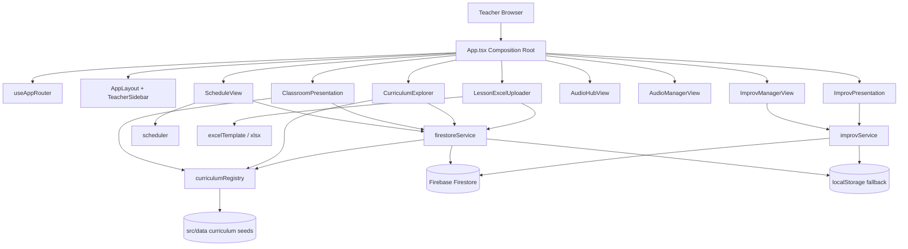
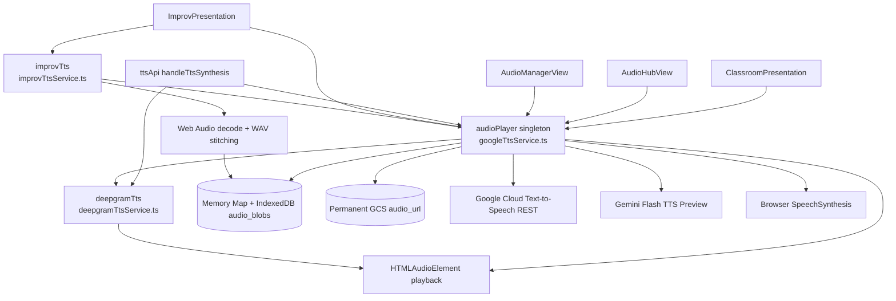

# Brain OS: CHUNKS Multi-Tier Classroom Platform & Knowledge Graph Governance (AGENTS.md)

You are operating within the **CHUNKS Teacher Classroom Platform** repository.
This repository governs a multi-tier, zero-bloat educational platform featuring live Google Cloud Firestore connectivity, in-browser Excel (.xlsx) ingestion, permanent GCS audio streaming, dynamic Deepgram Aura & Google Cloud TTS synthesis (Journey-F/M, Studio-O, Neural2-A), and wireless presenter remote clicker integration for English cohorts.

---

## 🏛️ 1. System Architecture & Repository Taxonomy

```text
chunks-class/
├── .github/workflows/              # Multi-tier CI/CD automation ($0/mo Always Free)
│   └── deploy-firebase.yml         # Typecheck, bundle build, and Firebase Hosting deployment
├── assets/                         # Public static assets & branding icons
├── src/
│   ├── api/                        # Modular API Endpoints (cohortsApi, lessonsApi, ttsApi)
│   ├── components/                 # UI Components (ClassroomPresentation, PartsDrawer, Sidebar, etc.)
│   ├── hooks/                      # Hardware Clicker (usePresenterClicker.ts) & Router (useAppRouter.ts)
│   ├── services/                   # Dynamic Registry, Firestore SDK, Deepgram & Google TTS
│   │   ├── curriculumRegistry.ts   # Dynamic In-Memory & Extensible Course Store
│   │   ├── firestoreService.ts     # Live Firestore Single-Doc Chunks Reader & Writer
│   │   ├── deepgramTtsService.ts   # Deepgram Aura Speech Engine
│   │   └── googleTtsService.ts     # Google Cloud TTS REST API Engine
│   ├── types/                      # Canonical Open Domain Models & TypeScript interfaces
│   └── utils/                      # Dynamic Recurrence Math & SheetJS Excel parser/generator
├── .firebaserc                     # Multi-site target mapping (chunks-classroom, default)
├── firebase.json                   # Granular cache-control (no-cache index.html, 1yr immutable assets)
└── firestore.rules                 # Production Firestore security rules
```

---

## 🤖 2. Multi-Agent Dispatching & Role Taxonomy (Osmani Agent Team Framework)

This repository enforces the **Osmani Agent Team Engineering Workflow** (based on `addyosmani/agent-skills` and Everything-Claude-Code). Agents are accountable roles; skills are reusable process playbooks. Do not treat a skill name as an agent, and do not invoke every installed skill by default. Select and use **all skills applicable to the change's risks and phase**, and record those selections in the work artifact.

| Agent Role | Persona / Specialization | Primary Jurisdiction | Responsibilities & Invariant Gates |
| :--- | :--- | :--- | :--- |
| **Lead Architect & Orchestrator** | `architect` / `planner` | Root, `src/types/`, Lifecycle | Owns project taxonomy, verifies specifications (`SPEC.md`), decomposes tasks into thin vertical slices, maintains system invariants, and coordinates cross-agent handoffs. |
| **Full-Stack Developer** | `developer` / `tdd-guide` | `src/`, `scripts/` | Implements thin vertical slices with red-green-refactor loop, writes clean TypeScript code, and verifies type consistency. |
| **Code Reviewer** | `code-reviewer` / `reviewer` | Diffs, Logic flows, Domain rules | **MANDATORY GATE**: Evaluates 5 axes (Correctness, Architecture, Readability, Security, Performance) against `LOGIC_FLOW.md` and repository domain rules before ANY change ships. |
| **Security Auditor** | `security-auditor` | Auth, Firestore, APIs, Secrets | Audits Firestore security rules, client-side secret exposure, input sanitization, and CORS headers. |
| **Test & QA Engineer** | `test-engineer` | Tests, Build, Clicker, Audio | Verifies test isolation, mock fidelity, audio playback edge cases, clicker debouncing, and hardware shortcut bindings. |
| **Delivery Gatekeeper** | `delivery-gate` / Lead | Build, CI/CD, Production Gate | Verifies `bun test`, `bun x tsc --noEmit`, and `bun run build`, audits release evidence, confirms peer review and human signoff, and prepares a reversible release. |

Applicable skills map to the lifecycle rather than replacing these roles: `intent-driven-development`, `spec-driven-development`, `planning-and-task-breakdown`, `test-driven-development`, `incremental-implementation`, `security-and-hardening`, `code-review-and-quality`, `verification-loop`, `shipping-and-launch`, and `git-workflow-and-versioning`. Add domain-specific skills when their trigger conditions apply; omit unrelated skills and state why when the omission could be surprising.

### 2.0 Mandatory Post-Change Peer Review Gate (NON-NEGOTIABLE)

> **STRICT RULE**: Every code, data, or configuration change—regardless of size, simplicity, or urgency—requires an independent reviewer before merge or release. Documentation-only changes may receive a proportionate review, but release-affecting documentation/configuration must still pass the required CI gates. “Trivial” never means “unreviewed.”
>
> The reviewer must use a fresh, independent context: provide the task, acceptance criteria, canonical invariants, exact diff/base SHA, and verification evidence, but not the author's conclusions or private reasoning. The reviewer must be a different agent/model or a human who did not implement the change, and MUST audit the diff against:
> 1. Domain ontology and invariants in `docs/LOGIC_FLOW.md`.
> 2. Zero-slop production standards (no mocks, no unhandled promises, clean cancellation).
> 3. Audio pipeline safety (no unhandled promises in `playUrl`, correct silence frame stitching, bucket URI canonicalization).
> 4. Firestore read/write quota rules (single-doc chunk containment, ID-based deduplication, batch update field filtering).
> 5. Test, typecheck, and build cleanliness (`bun test`, `bun x tsc --noEmit`, and `bun run build`).

---

## 🧭 2.1 Codebase Graphify Research Map


Current graph entrypoints and ownership boundaries:

```text
App.tsx
├── useAppRouter.ts                         # URL route <-> NavTab mapping
├── AppLayout.tsx / TeacherSidebar.tsx       # Main shell and navigation
├── ScheduleView.tsx                         # Cohort calendar, session launch
├── ClassroomPresentation.tsx                # Lesson/chunk projector runtime
├── ImprovManagerView.tsx                    # Improv package authoring/runtime management
├── ImprovPresentation.tsx                   # Hint-based classroom projector runtime
├── CurriculumExplorer.tsx                   # Course/lesson browsing and sync surface
├── AudioHubView.tsx                         # Voice presets, API keys, day-level audio prep
├── AudioManagerView.tsx                     # Course-level audio readiness, batch prep, chunk audition/edit
├── SettingsView.tsx                         # Firestore sync and diagnostics
└── LessonExcelUploader.tsx                  # XLSX lesson ingestion

src/services/
├── firestoreService.ts                      # Firebase app, courses, lessons, cohorts, single-doc chunks, batch sync
├── curriculumRegistry.ts                    # In-memory course/lesson fallback and dynamic registry
├── googleTtsService.ts                      # Central audio facade: cache, playback, provider routing, Google/Gemini TTS
├── deepgramTtsService.ts                    # Deepgram Aura voice list, sanitizer, REST synthesis
├── improvService.ts                         # Improv CRUD, local fallback, XLSX/LLM generation helpers
├── improvTtsService.ts                      # Improv hint/item audio synthesis, Web Audio stitching, IndexedDB cache
├── firebase.ts                              # Firebase config export for shared consumers
└── speechService.ts                         # Local speech engine helper

src/types/
├── index.ts                                 # Course, lesson, chunk, cohort, audio, nav contracts
└── improv.ts                                # Improv package/session/item/hint contracts

src/utils/
├── scheduler.ts                             # Cohort recurrence and default cohort generation
└── excelTemplate.ts                         # XLSX template generation and GCS audio URL conventions
```

Primary data graph:

```text
Firestore collections
├── /courses/{courseId}                      # Dynamic course metadata
├── /lessons/{lessonId}                      # Single document per lesson; chunks live in doc.data().chunks[]
├── /cohorts/{cohortId}                      # Schedule, sessions, audio_settings
└── /improv_packages/{packageId}             # Improv sessions/items/hints

Fallback stores
├── curriculumRegistry                       # Seeded Level A, Level B EREL, Level B ERES
├── localStorage: chunks_firestore_synced_cohorts
├── localStorage: chunks_improv_packages_local
├── localStorage: chunks_active_audio_provider
├── localStorage: chunks_custom_tts_api_keys
├── localStorage: chunks_deepgram_api_key
└── IndexedDB: chunks_audio_db/audio_blobs   # Prepared TTS blobs keyed by voice::text and improv item/hint keys
```

Architectural invariants discovered and enforced across the codebase:

1. **Composition Root**: `App.tsx` is the sole composition root; it owns active cohort, session selection, lesson navigation, and projector state.
2. **Firestore Single-Doc Chunks Invariant**: `firestoreService.ts` is the single Firestore data gateway. Chunks are strictly stored in the contiguous array `doc.data().chunks: ChunkItem[]` within `/lessons/{lessonId}`. Querying chunk subcollections is **STRICTLY FORBIDDEN** to preserve the $0/mo Always Free tier.
3. **Lesson Deduplication Invariant**: In `firestoreService.ts`, `deduplicateLessons` MUST deduplicate strictly by unique `lesson.id` (`idMap.set(lesson.id, lesson)`), NEVER by `day_number`. Multiple inactive or orientation lessons share `day_number = 0`; keying by `day_number` causes catastrophic silent lesson deletion.
4. **Elastic Cohort Session Alignment**: In `syncCourseCohortsWithActiveLessons`, never clamp session count using `Math.min(cohort.sessions.length, activeLessons.length)`. Clamping prevents cohort expansion when disabled lessons are re-enabled. Always set `targetCount = activeLessons.length`, project missing recurrence dates via `schedule_pattern.days_of_week`, and update `cohort.total_sessions`.
5. **Batch Update Optimization**: Never write entire chunk arrays during lesson metadata updates (titles, active states, display orders). Write only `{ is_active, display_title, lesson_title, day_number, updated_at }` with a 6-second `Promise.race` timeout guard and dual-persist to localStorage (`chunks_lesson_overrides`).
6. **First Active Lesson Fallback**: When launching `ClassroomPresentation` or switching courses, never default blindly to Day 0 (e.g. Day 0 Word List when `is_active === false`). Always resolve to the first active curriculum lesson: `curriculumRegistry.getLessons(courseLevel).find(l => l.is_active !== false)`.
7. **Auxiliary Courses Hidden by Default**: Auxiliary courses (`LEVEL_B_EREL` and `LEVEL_B_ERES`) MUST be hidden by default across all selectors (`CurriculumExplorer`, `AudioManagerView`, `CohortModal`, `ScheduleView`, `ClassroomPresentation`).
8. **Canonical Audio Storage Bucket**: The only verified Firebase Storage bucket is `chunks-voicecloning-genshai.firebasestorage.app` (configured with `Access-Control-Allow-Origin: *` on GCP). The legacy bucket `chunks-mirror-audio-284566312743` returns 404 without CORS headers and triggers `net::ERR_FAILED` in browser consoles.
9. **Audio Double-Playback Prevention**:
   - Check active cohort `audio_settings.repeat_count` in `/cohorts/{cohortId}` (repeat count > 1 causes bilingual sequences to repeat).
   - In `audioPlayer.playUrl`, `cancel()` must reject the Promise with a cancellation error and clear `audio.src = ''` instead of resolving cleanly; otherwise cancelled audio promises cascade into duplicate subsequent speech.
10. **Google Cloud TTS Journey Voice Prosody & Anti-Clipping**:
    - Journey voices (`en-US-Journey-D`, `en-US-Journey-F`) do NOT support SSML (triggers 400 `INVALID_ARGUMENT`); use plain text only.
    - Prepend 240ms of MPEG-2 Layer III 24kHz 32kbps mono silence frames (10 frames x 96 bytes: hex `fff344c453000003480000000055...`) to prevent DAC/buffer startup latency from clipping initial consonants (e.g., "P" in "Plus").
    - Normalize trailing punctuation to `.` (or `?`) and append 288ms silence frames (12 frames x 96 bytes) to prevent abrupt cutoff.
    - Insert a comma after introductory discourse markers (`Plus, I...`, `Look, this...`, `Come on, you...`) to force natural pause and clear articulation.
11. **Level A Grammar Points vs Level B 3-Column Architecture**:
    - **Level A Grammar**: Uses dynamic `grammar_points` cards (1 to 3 cards) matching *Level A - Grammar - Chunker.pdf*, 100% English-only. Emphasized focus words are styled with `font-bold underline decoration-2 underline-offset-2 break-words leading-snug` (WITHOUT red text color or border badge pills). Items starting with `---` render as visual contrast dividers.
    - **Level B Grammar**: Uses 3 static columns (`Sentence Structures`, `Verb Forms & Phrases`, `Tenses & Patterns`).
12. **Part Transition Audio Canonical Keys**:
    - Derive canonical part keys via `deriveCanonicalPartKey(partTitle, partNumber)` (e.g. `part_vocab_check`, `part_lesson_1_phrase_check`). In `findPartOverride`, prioritize exact key and exact clean title match before generic `partNumber` fallback. (In Level A, 6 distinct lessons share "Part 1"; matching on `partNumber` alone causes override collisions).
    - In `LessonPart`, always preserve `raw_part` and `part_key`.
    - For two-topic lessons (`EREL`), use `effectivePartNum = targetPart.part_in_topic || targetPart.part_index`.
---

## 🏗️ 2.2 Archify Visualization Of Current Project



Audio/TTS runtime graph:



---

## 📐 3. Dynamic Database & Domain Contracts

### 3.1 Fully Dynamic Course & Lesson Storage
- **No Hardcoded Level Lock-in**:
  - `CourseLevel` is an extensible type (`LEVEL_A`, `LEVEL_B`, `LEVEL_C`, `IELTS_DRILL`, `CUSTOM`).
  - Courses are dynamically loaded from Firestore collection `/courses/{courseId}` with `curriculumRegistry` fallback.
- **Single-Doc Chunks Array**:
  - All chunks of a lesson are stored in a contiguous array field `doc.data().chunks: ChunkItem[]`.
  - **Strict Prohibition**: Never query subcollections for chunks (preserves $0/mo Firestore free tier quotas).

### 3.2 Dynamic Cohort Auto-Scheduler Contract
- **Calculation Rule**: Given a `start_date`, `days_of_week`, and `total_sessions` (arbitrary N sessions), `calculateSessions` generates sequential calendar dates using timezone-safe local noon date arithmetic.
- **Status Preservation**: Modifying cohort schedules preserves existing `completed` and `in_progress` session statuses.

### 3.3 Multi-Provider Audio / TTS Architecture
- **Central Facade**: `googleTtsService.ts` exports the singleton `audioPlayer`, which owns provider selection, prepared audio cache, source listeners, loading listeners, playback cancellation, and Google/Gemini key-pool failover.
- **Text Sanitization**: `sanitizeSpeechText` is exported from `deepgramTtsService.ts` and re-exported by `googleTtsService.ts`; it converts `//`, `|`, semicolons, and slash-separated alternatives into speech-safe prosody.
- **Persistent Prepared Cache**:
  1. Memory `Map<string, string>` for instant current-session playback.
  2. IndexedDB database `chunks_audio_db`, store `audio_blobs`, for browser-persistent synthesized audio.
  3. Cache keys include direct text, sanitized text, and `voice::sanitizedText` composite keys; Improv uses `improv_hint_*` and `improv_item_*` keys.
- **English Runtime Priority**:
  1. Prepared cache (`audioPlayer.getCachedAudioAsync`).
  2. Deepgram Aura when provider is `DEEPGRAM_AURA` or voice starts with `aura-*`.
  3. Permanent GCS `chunk.audio_url` only when using the default/non-custom Google path and not forcing cloud TTS.
  4. Google Cloud Text-to-Speech for `en-US-*` voices.
  5. Gemini Flash TTS Preview when the active key type starts with `AQ.`.
  6. Browser Speech Synthesis fallback with `en-US`.
- **Vietnamese Runtime Priority**:
  1. Prepared cache with a `vi-*` voice.
  2. Google Cloud Text-to-Speech with `vi-VN-*` voices (`Neural2`, `WaveNet`, `Standard`, `Chirp3-HD`).
  3. Browser Speech Synthesis fallback with `vi-VN`.
  4. Deepgram and `en-US-*` voices must not be used for Vietnamese text.
- **Batch Preparation**: `prepareChunksAudio` runs a bounded worker pool (`1..8`) over lesson chunks and can target English, Vietnamese, or both; `AudioHubView` triggers day-level prep and `AudioManagerView` triggers lesson/course-level prep.
- **Improv Audio Layer**: `improvTtsService.ts` can synthesize single hints, combine all hints in an `ImprovItem` with Web Audio and ~1 second silence gaps, encode the result to WAV, and persist both hint and item audio to the shared IndexedDB-backed cache.
- **Race Condition Protection**: `activeSequenceId` in `audioPlayer` and `improvTts`, plus `activeSequenceRef` in `ImprovPresentation`, invalidate in-flight playback/timeouts upon clicker navigation, stop, or replay.
- **Diagnostic Surfaces**: `AudioDiagnosticModal`, `AudioHubView`, and `AudioManagerView` expose source status, provider switching, key testing, cache readiness, and audition flows.

### 3.4 Hardware Remote Clicker Mappings
- `PageDown` / `Space` / `ArrowRight`: Advance to next chunk & play audio.
- `PageUp` / `ArrowLeft`: Return to previous chunk.
- `Key R`: Replay active chunk audio.
- `Key B` / `Period`: Toggle pitch-black blackout overlay (`#000000`).
- `Key V`: Toggle Vietnamese subtitle visibility.
- `Key L`: Toggle Word & Chunks List drawer.
- `Key P`: Toggle Parts Navigation drawer.
- `Key F` / `F5`: Toggle Fullscreen mode.

---

## 🚀 4. CI/CD & Multi-Domain Hosting ($0.00 / Month Always Free)

### Automated Pipeline:
- **Trigger**: Push to `main`, pull request to `main`, or manual `workflow_dispatch`.
- **Quality job (all triggers)**: frozen install, `bun test`, `bun x tsc --noEmit`, `bun run build`; the verified bundle is uploaded as a CI artifact.
- **Preview**: Pull requests deploy an isolated Firebase Hosting preview channel (`pr-{number}`, 7-day expiry). This is the link that must be reviewed before production.
- **Production**: `workflow_dispatch` with `channel=live` only, gated by the GitHub `production` environment reviewer. A push to `main` **never** deploys live automatically.
- **Target Site**: `chunks-classroom` → **`https://chunks-classroom.web.app`**.
- **Caching Discipline**:
  - `/index.html`: `no-cache, no-store, must-revalidate` (guarantees instant updates on new deploys).
  - `/assets/**`: `public, max-age=31536000, immutable` (1-year immutable cache for content-hashed bundles).

---

## ⚡ 5. Strict Zero-Slop & Quality Assurance Principles

1. **Zero Mockups in Production**: Always load live data from Firestore / dynamic registry.
2. **Vietnamese Typography Safety**: All components load and render `Be Vietnam Pro` (Latin Extended).
3. **$0.00 / Month Always-Free Discipline**:
   - Firestore: ≤ 50,000 reads, 20,000 writes/day.
   - Cloud TTS / Deepgram: Controlled caching and batch worker pool.
   - Firebase Hosting: ≤ 10 GB storage, 360 MB/day egress.
4. **Continuous Verification**: Prior to merge, execute `bun test`, `bun x tsc --noEmit`, and `bun run build`. A green local run is necessary but not sufficient: the PR preview channel must be reviewed, and the production environment must be approved by a human.

### 4.1 Known Release Blockers (must remain visible until resolved)

These are pre-existing production risks, not optional follow-ups. Do not describe a release as production-ready while any remain open:

1. **Provider credentials in the client/bundle**: Google TTS, Gemini, and Deepgram billable keys must be revoked/rotated and moved behind an authenticated, rate-limited backend proxy. A Firebase web API key may be public only when properly restricted; billable TTS keys are not client secrets.
2. **Allow-all Firebase rules**: `firestore.rules` and `storage.rules` must require authentication/role-based authorization, pass emulator tests, and be verified in the deployed project. CI deploys Hosting only; rule deployment is a separate, reviewed step.
3. **Destructive operational scripts**: untracked/one-off sync/upload scripts must not be committed or run without `--apply`, project-ID verification, dry-run diff, backup/export, bounded writes, and rollback instructions.
4. **Noise and provenance**: `index.html` caching must be verified at the deployed URL; deployed asset hashes and rollback SHA must be recorded per release.

### 4.2 Definition of Done & Release Provenance

A change is done only when all of the following are attached to the work artifact:

- [ ] Scope, acceptance criteria, and applicable skills recorded.
- [ ] Red-green proof: failing test first (where behavior changed), then passing focused tests.
- [ ] `bun test`, `bun x tsc --noEmit`, and `bun run build` pass; output included.
- [ ] Independent code, security, and test review sign-offs with severity-labeled findings resolved or explicitly deferred.
- [ ] Preview channel URL reviewed and approved by a human.
- [ ] Branch/SHA, base SHA, CI run URL, deployed asset hash, and rollback target recorded.
- [ ] No secrets, generated credentials, or destructive scripts added to the diff.
- [ ] Migration/data changes have a dry-run diff, backup, and rollback path.

---

## 🛡️ 6. Osmani Multi-Agent SDLC & Subagent Delegation Lifecycle

This repository mandates the **5-Phase Osmani Agent Team Lifecycle** for all non-trivial engineering tasks:

```text
┌─────────────────────────────────────────────────────────────────────────────┐
│                       OSMANI AGENT TEAM SDLC PIPELINE                       │
├──────────────┬──────────────┬──────────────┬───────────────┬────────────────┤
│   PHASE 1    │   PHASE 2    │   PHASE 3    │    PHASE 4    │    PHASE 5     │
│ Spec & Plan  │ Build & TDD  │ Verify Proof │ 5-Axis Review │   Gated Ship   │
├──────────────┼──────────────┼──────────────┼───────────────┼────────────────┤
│ Architect /  │ Developer /  │ QA / Build   │ Code Reviewer │ Delivery Gate  │
│ Planner      │ TDD Guide    │ Test Runner  │ Sec Auditor   │ Human-in-Loop  │
│              │              │              │ Test Engineer │ Signoff        │
└──────────────┴──────────────┴──────────────┴───────────────┴────────────────┘
```

### 6.1 Phase Breakdown & Jurisdiction

1. **Phase 1: Spec & Plan**
   - Architect/Planner verifies contracts, types in `src/types/`, and flow models in `docs/LOGIC_FLOW.md`.
   - Decomposes requirements into thin vertical slices with clearly specified acceptance criteria.
2. **Phase 2: Build & TDD Implementation**
   - Developer implements minimal, zero-bloat code to satisfy specification.
   - Follows project conventions: typed props, React hooks, `audioPlayer` singleton, Firestore single-doc schemas.
3. **Phase 3: Verify Proof**
   - Runs the full unit suite: `bun test`.
   - Runs static typechecking: `bun x tsc --noEmit`.
   - Runs production bundle compilation: `bun run build`.
   - Verifies zero regression in uncommitted diffs and records exact command output.
4. **Phase 4: Parallel 5-Axis Peer Review (MANDATORY)**
   - Dispatches independent review agents before shipping:
     - **Correctness & Architecture (`code-reviewer`)**: Audits against logic flows, sequence safety, and single-doc rules.
     - **Readability & Standards (`reviewer`)**: Audits zero-slop code, clean variable names, and maintainability.
     - **Security & Boundaries (`security-auditor`)**: Audits Firestore security rules, client storage, API key protection, and GCS bucket access.
     - **Test & Edge-Case Integrity (`test-engineer`)**: Audits clicker debouncing, cancellation promises, audio caching, and audio repeat loops.
5. **Phase 5: Gated Ship**
   - Resolves any blocking findings from the 5-axis review, or records an explicit human-approved deferral.
   - Verifies CI/CD readiness (`.github/workflows/deploy-firebase.yml`): quality job green, preview channel deployed, production environment protected.
   - **Never pushes to `main`, merges, or deploys live without explicit human approval.** The approval must name the approver, the preview URL reviewed, the merge/deploy SHA, and the rollback target.
   - Documents the release artifact: branch/SHA, base SHA, CI run URL, preview URL, deployed asset hash, Definition of Done checklist, and changelog/commit message.

### 6.2 Strict Orchestration Guardrails

1. **Zero Monolithic Execution in Parent Context**:
   - The Lead Orchestrator is **STRICTLY PROHIBITED** from monolithic multi-file rewrites without clear domain decomposition.
2. **Mandatory Subagent Dispatching**:
   - All multi-step features, audits, and reviews must be dispatched to specialized agents (`code-reviewer`, `security-auditor`, `test-engineer`, `task`).
3. **Mandatory Independent Code Review**:
   - **NO CHANGE IS SHIPPED WITHOUT PEER REVIEW SIGN-OFF**. The reviewer must explicitly evaluate the diff against the domain invariants codified in this document and `docs/LOGIC_FLOW.md`.
