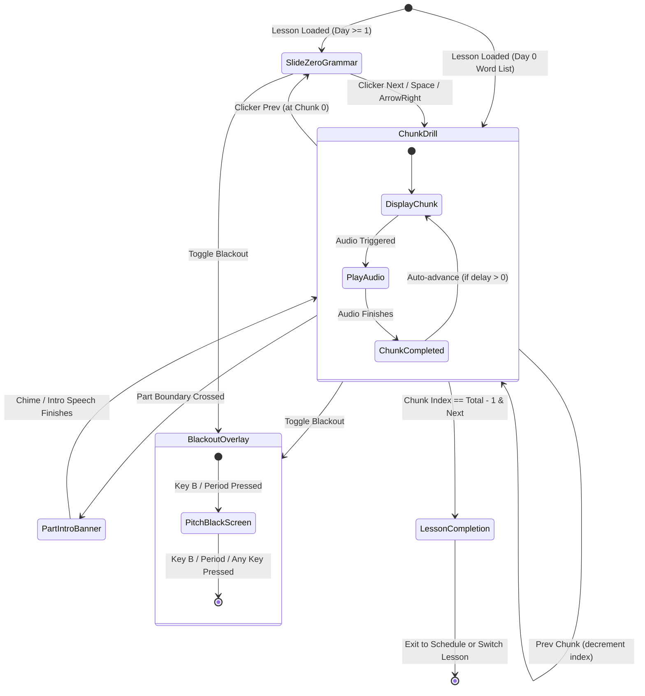
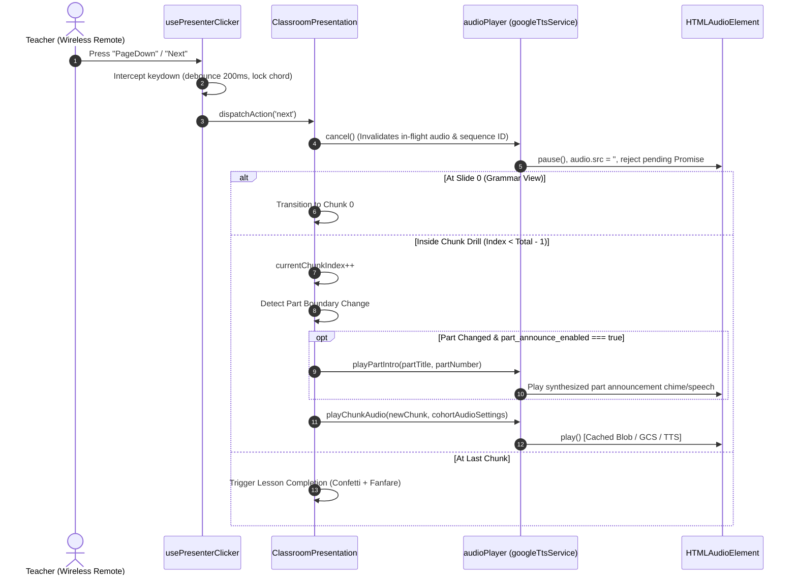
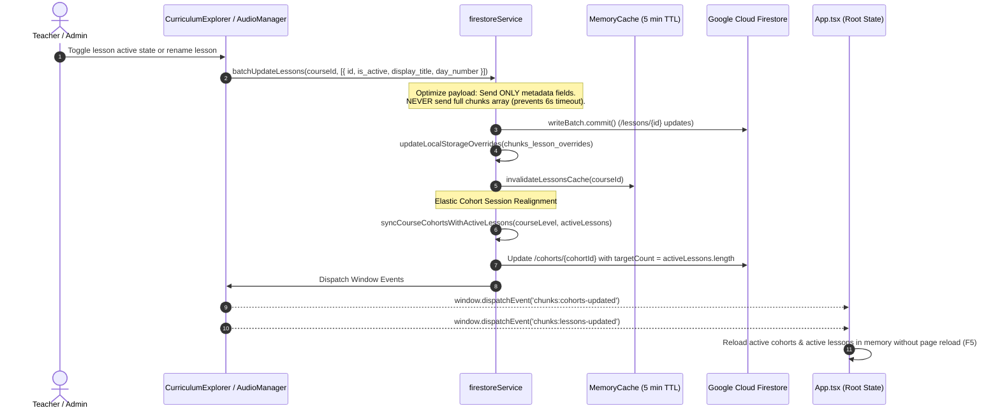
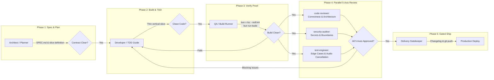

# CHUNKS Classroom Platform: Domain Ontology & Module Logic Flows

This document is the authoritative architectural specification and execution ontology for the **CHUNKS Classroom Platform**. It formalizes the domain data contracts, module responsibilities, runtime state machines, multi-tier audio resolution cascade, Firestore synchronization mechanics, and the Osmani multi-agent engineering review pipeline.

---

## 📑 Table of Contents

1. [Architectural Philosophy & System Principles](#1-architectural-philosophy--system-principles)
2. [Domain Model Ontology & TypeScript Contracts](#2-domain-model-ontology--typescript-contracts)
   - 2.1 Course & Curriculum Entities
   - 2.2 Lesson Document & Contiguous Chunks Model
   - 2.3 Grammar Entities (Level A Dynamic Cards vs Level B 3-Column Analysis)
   - 2.4 Cohort, ClassSession & Dynamic Scheduling
   - 2.5 Lesson Parts, Topics & Audio Canonical Keys
   - 2.6 Hardware Remote Clicker Action Contracts
3. [Module Responsibility Matrix & Dependency Topology](#3-module-responsibility-matrix--dependency-topology)
   - 3.1 Presentation & Stage Layer
   - 3.2 Hardware Clicker & Interaction Layer
   - 3.3 Audio Engine & Multi-Provider Layer
   - 3.4 Data & Persistence Gateway Layer
   - 3.5 Course Management & Administration Layer
4. [Detailed Execution Logic Flows](#4-detailed-execution-logic-flows)
   - [Flow A: Classroom Presentation & Clicker Hardware State Machine](#flow-a-classroom-presentation--clicker-hardware-state-machine)
   - [Flow B: Multi-Provider Audio Pipeline & Fallback Cascade](#flow-b-multi-provider-audio-pipeline--fallback-cascade)
   - [Flow C: Level A vs Level B Grammar Rendering Architecture](#flow-c-level-a-vs-level-b-grammar-rendering-architecture)
   - [Flow D: Firestore Read/Write Single-Doc Sync & Cache Invalidation](#flow-d-firestore-readwrite-single-doc-sync--cache-invalidation)
   - [Flow E: Osmani Multi-Agent Review & Delivery Pipeline](#flow-e-osmani-multi-agent-review--delivery-pipeline)
5. [Critical Invariant & Edge Case Catalog](#5-critical-invariant--edge-case-catalog)

---

## 1. Architectural Philosophy & System Principles

The CHUNKS Classroom Platform is designed for high-stakes, real-time classroom instruction. It operates under four strict engineering tenets:

1. **Zero-Latency Stage Response**: Teacher inputs from wireless remote presentation clickers (`PageDown`, `PageUp`, `B`, `V`, `R`) must execute synchronously in `<16ms` without blocking on network requests or frame drops.
2. **$0.00 / Month Always-Free Tier Discipline**:
   - Firestore: All chunks of a lesson are stored in a contiguous array within a single document (`/lessons/{lessonId}.chunks[]`). Chunk subcollections are **strictly forbidden** to prevent quota exhaustion ($0/mo limit: 50,000 reads/day).
   - In-memory 5-minute TTL caching and `SingleFlight` promise deduplication eliminate duplicate reads during component remounts.
3. **Multi-Tier Audio Fallback**: Audio resolves gracefully through five fallback layers (Memory -> IndexedDB -> Permanent GCS -> Deepgram Aura/Flux -> Google Cloud TTS -> Gemini TTS -> Web Speech API) so that classroom playback never stalls.
4. **Mandatory Post-Change Peer Review Gate**: No code change is shipped without an independent peer review verifying adherence to the ontology and invariants codified herein.

---

## 2. Domain Model Ontology & TypeScript Contracts

```text
┌─────────────────────────────────────────────────────────────────────────────┐
│                       CHUNKS PLATFORM DOMAIN ONTOLOGY                       │
├─────────────────────────────────────────────────────────────────────────────┤
│                                                                             │
│   Course (1) ─────────── contains ───────────< LessonDoc (N)                │
│     │                                             │                         │
│     │ generates                                   ├── chunks: ChunkItem[]   │
│     ▼                                             │   (contiguous array)    │
│   Cohort (M) ─────────── schedules ───────────<   └── grammar: LessonGrammar│
│     │                                                 (Level A / Level B)   │
│     ├── sessions: ClassSession[]                                            │
│     │     (session_number, lesson_id, date)                                 │
│     └── audio_settings: CohortAudioSettings                                 │
│           (repeat_count, language_mode, voices)                             │
│                                                                             │
└─────────────────────────────────────────────────────────────────────────────┘
```

### 2.1 Course & Curriculum Entities (`src/types/index.ts`)

```typescript
export type KnownCourseLevel = 
  | 'LEVEL_A' 
  | 'LEVEL_B' 
  | 'LEVEL_B_ERE' 
  | 'LEVEL_B_EREL' 
  | 'LEVEL_B_ERES' 
  | 'LEVEL_C' 
  | 'IELTS_DRILL' 
  | 'BUSINESS_CHUNK_PRO';

export type CourseLevel = KnownCourseLevel | (string & {});

export interface Course {
  id: string;                      // Canonical course ID (e.g., "course_level_a", "course_level_b")
  level_code: CourseLevel;         // Level classification identifier
  title: string;                   // Human-readable title
  description: string;
  total_days: number;              // Total distinct instructional days
  total_chunks: number;            // Total phrase/sentence chunks
  default_sessions_count?: number; // Default cohort session count (e.g., 15, 20, 30)
  is_active: boolean;              // Global active toggle
  metadata?: Record<string, any>;
}
```

- **Auxiliary Course Rule**: `LEVEL_B_EREL` (Listening focus) and `LEVEL_B_ERES` (Speaking focus) are auxiliary sub-courses. They are **hidden by default** in all UI dropdowns and schedules unless explicitly enabled.

### 2.2 Lesson Document & Contiguous Chunks Model

```typescript
export interface LessonDoc {
  id: string;                      // Document key: "level_a_day_1", "level_b_day_2"
  course_id?: string;              // Foreign key to courses.id
  level_code: CourseLevel;         // Associated course level code
  day_number: number;              // 0 (Word list), 1 (Orientation), 2..N (Drill)
  lesson_title: string;            // Canonical curriculum lesson title
  display_title?: string;          // Dynamic override display title
  is_active?: boolean;             // Enabled/disabled in projector & schedule (default: true)
  display_order?: number;          // Presentation order sort key
  lesson_type: string;             // 'standard' | 'free_talk' | 'orientation' | 'grammar' | 'final_test'
  total_chunks: number;            // Length of the chunks array
  categories: string[];            // ['vocab', 'phrase', 'sentence', 'review', etc.]
  chunks: ChunkItem[];             // Contiguous array containing all chunks (SINGLE-DOC INVARIANT)
  grammar?: LessonGrammar;         // Attached grammar overview specification
}

export interface ChunkItem {
  chunk_id: string;                // Unique chunk ID: "chunk_la_d2_0001", "chunk_ere_d1_0002"
  item_number: number;             // 1-based index within the lesson
  category: ChunkCategory;         // 'vocab' | 'phrase' | 'sentence' | 'slang' | 'review' | ...
  english: string;                 // Target English phrase/sentence
  vietnamese: string;              // High-quality Vietnamese pedagogical translation
  speaker: string | null;          // Speaker identifier (e.g., "A", "B", or null)
  audio_url?: string | null;       // Permanent GCS URL for primary English audio
  audio_url_vi?: string | null;    // Permanent GCS URL for secondary Vietnamese audio
  audio_url_human?: string | null; // Human voice recording URL
  audio_url_tts?: string | null;   // Synthesized TTS URL
  audio_source_preferred?: 'human' | 'tts';
  part?: string;                   // Original part designation (e.g., "Part 1 - Vocabulary Check")
  is_example?: boolean;            // Flag for slang example sentences
}
```

### 2.3 Grammar Entities: Level A Dynamic Cards vs Level B 3-Column Analysis

The system supports two distinct grammar presentation models:

```typescript
export interface LessonGrammar {
  // Level B Static 3-Column Model
  verb_forms: string[];            // Column 2: Verb forms & collocations
  sentence_structures: string[];   // Column 1: Core sentence formulas
  tense: string[];                 // Column 3: Tense & reflex patterns

  // Level A Dynamic Cards Model
  grammar_points?: Array<{
    title: string;                 // e.g., "1. To be: Am / Is / Are", "2. Negative sentences"
    items: string[];               // Spoken chunks with **target** highlights and '---' dividers
    notes?: string;                // Pedagogical notes / explanations
  }>;

  mini_lessons?: GrammarMiniLesson[];
  thematic_module?: string;
  cohort_day_15?: number | null;
  lesson_number_19?: number | null;
}
```

- **Level A Grammar Invariant**: 100% English-only. Uses dynamic `grammar_points` cards (1 to 3 cards). Tokens enclosed in `**...**` are styled with `font-bold underline decoration-2 underline-offset-2 break-words leading-snug` (strictly without red text color or border badge pills). Items beginning with `---` render as visual contrast dividers.
- **Level B Grammar Invariant**: 3-column analysis grid partitioned into `sentence_structures`, `verb_forms`, and `tense`.

### 2.4 Cohort, ClassSession & Dynamic Scheduling

```typescript
export interface Cohort {
  id: string;                      // Document key in /cohorts/{id}
  title: string;                   // e.g., "Level A - K24"
  level_code: CourseLevel;
  course_id: string;
  teacher_id: string;
  start_date: string;              // ISO Date: YYYY-MM-DD
  schedule_pattern: {
    days_of_week: string[];        // ["Mon", "Wed", "Fri"]
    start_time: string;            // "19:00"
    end_time: string;              // "21:00"
  };
  total_sessions: number;          // Dynamic session count (N sessions)
  sessions: ClassSession[];        // Ordered sequential session slots
  audio_settings?: CohortAudioSettings;
  is_active?: boolean;
}

export interface ClassSession {
  session_number: number;          // 1 to N
  scheduled_date: string;          // YYYY-MM-DD (calculated by local noon recurrence math)
  day_of_week: string;             // "Mon", "Wed", "Fri"
  start_time: string;
  end_time: string;
  day_number: number;              // Foreign key mapping to LessonDoc.day_number
  lesson_id: string;               // Foreign key mapping to LessonDoc.id
  lesson_title: string;
  lesson_type: string;
  status: 'scheduled' | 'in_progress' | 'completed' | 'cancelled';
}

export interface CohortAudioSettings {
  voice_profile_primary?: string;   // e.g., 'flux-cliff-en', 'en-US-Journey-D'
  voice_profile_secondary?: string; // e.g., 'vi-VN-Neural2-A'
  language_mode: LanguageMode;      // 'EN_ONLY' | 'VI_ONLY' | 'EN_THEN_VI' | 'VI_THEN_EN'
  auto_advance_delay_sec: number;   // Auto-advance delay in seconds (0 = manual clicker)
  default_speed: number;            // 0.8 to 1.2
  repeat_count: number;             // Audio playback repetitions (default: 1; >1 loops playback)
  provider_primary?: string;        // 'DEEPGRAM_AURA' | 'GOOGLE_TTS'
  part_announce_enabled?: boolean;  // Play voice intro on part transitions
}
```

### 2.5 Lesson Parts, Topics & Audio Canonical Keys

```typescript
export interface LessonPart {
  part_index: number;              // 1 to N
  category: string;                // 'vocab' | 'phrase' | 'teamwork' | 'review'
  title: string;                   // Clean display title (e.g., "Vocabulary Check")
  raw_part?: string;               // Original chunk.part string
  part_key?: string;               // Canonical slug key (e.g., "part_1_vocab_check")
  start_index: number;             // Starting chunk index
  end_index: number;               // Ending chunk index (inclusive)
  chunk_count: number;
  topic_number?: 1 | 2;            // For 2-topic lessons (e.g., EREL)
  topic_title?: string;
  part_in_topic?: number;          // 1 to 7 within respective topic
}
```

- **Canonical Key Derivation**: Always generated via `deriveCanonicalPartKey(partTitle, partNumber)`.
- **Two-Topic Resolution**: For 2-topic lessons (`EREL`), effective part number is resolved as `targetPart.part_in_topic || targetPart.part_index`.

### 2.6 Hardware Remote Clicker Action Contracts

```typescript
export type ClickerAction = 
  | 'next'        // PageDown, ArrowRight, Space -> Advance & play
  | 'prev'        // PageUp, ArrowLeft -> Back (play optional based on behavior)
  | 'replay'      // Key R -> Replay current chunk audio
  | 'blackout'    // Key B, Period -> Toggle pitch-black overlay (#000000)
  | 'subtitle'    // Key V -> Toggle Vietnamese subtitle translation
  | 'drawer'      // Key P / Key L -> Toggle Parts Drawer / Word List
  | 'fullscreen'  // Key F, F5 -> Toggle projector fullscreen mode
  | 'digit1'      // Key 1 -> Play Primary Audio (EN)
  | 'digit2'      // Key 2 -> Play Secondary Audio (VI)
  | 'digit3';     // Key 3 -> Play Bilingual Sequence (EN then VI)
```

---

## 3. Module Responsibility Matrix & Dependency Topology

```text
┌─────────────────────────────────────────────────────────────────────────────┐
│                           SYSTEM COMPOSITION ROOT                           │
│                                  App.tsx                                    │
└──────────────┬──────────────────────────────┬───────────────────────────────┘
               │                              │
       Presentation Layer             Data / Audio Layer
               │                              │
  ┌────────────┴─────────────┐   ┌────────────┴──────────────────────────────┐
  │ ClassroomPresentation.tsx│   │ firestoreService.ts (Single-Doc Reader)   │
  │ PartsDrawer.tsx          │   │ curriculumRegistry.ts (In-Memory Catalog) │
  │ GrammarSlideView.tsx     │   │ googleTtsService.ts (audioPlayer Singleton)│
  │ usePresenterClicker.ts   │   │ deepgramTtsService.ts (Aura / Flux REST)  │
  └──────────────────────────┘   └───────────────────────────────────────────┘
```

| Module | Location | Primary Responsibility | Critical Invariants |
| :--- | :--- | :--- | :--- |
| `App.tsx` | `src/App.tsx` | Composition root, top-level routing, active cohort state, projector modal mount. | Owns `activeCohort`, resolves first active lesson on mount, listens to `chunks:cohorts-updated`. |
| `ClassroomPresentation.tsx` | `src/components/ClassroomPresentation.tsx` | Main projector stage, chunk slides, slide 0 grammar view, audio playback triggers. | Uses `activeSequenceId` to cancel delayed audio on slide advance; handles blackout and fullscreen. |
| `usePresenterClicker.ts` | `src/hooks/usePresenterClicker.ts` | Listens to physical USB/Bluetooth presenter remote clickers and keyboard events. | Implements 200ms debouncing, chord lock prevention, and mode-based behavior (`focus` vs `improv`). |
| `PartsDrawer.tsx` | `src/components/PartsDrawer.tsx` | Sliding drawer for direct navigation across lesson parts, inline auditioning. | Preserves `raw_part` and `part_key`; uses `e.stopPropagation()` during auditioning. |
| `GrammarSlideView.tsx` | `src/components/GrammarSlideView.tsx` | High-contrast pedagogical slide for grammar overview (Slide 0). | Dynamic cards for Level A (`grammar_points`); 3-column static grid for Level B; unified font stepper 1..8. |
| `googleTtsService.ts` | `src/services/googleTtsService.ts` | Exports `audioPlayer` singleton; manages caching, playback queue, and provider fallback. | `cancel()` rejects pending Promise; clears `audio.src = ''`; prepends/appends Journey silence frames. |
| `deepgramTtsService.ts` | `src/services/deepgramTtsService.ts` | Deepgram Aura & Flux REST client; speech text prosody sanitizer. | Flux uses `/v2/speak`; Aura uses `/v1/speak`; sanitizes slashes and semicolons into prosodic pauses. |
| `firestoreService.ts` | `src/services/firestoreService.ts` | Single Firestore data gateway for courses, lessons, and cohort sync. | Single-doc chunks array; singleFlight deduplication; ID-based lesson deduplication; metadata-only batch updates. |
| `curriculumRegistry.ts` | `src/services/curriculumRegistry.ts` | In-memory catalog seeded from TypeScript datasets for offline-first operation. | Seed data for Level A, Level B ERE, Level B EREL, and Level B ERES. |

---

## 4. Detailed Execution Logic Flows

---

### Flow A: Classroom Presentation & Clicker Hardware State Machine

The classroom presentation engine runs a deterministic state machine driven by wireless remote presentation clickers or keyboard shortcuts.

#### State Machine Diagram



#### Clicker Event & Playback Execution Sequence



---

### Flow B: Multi-Provider Audio Pipeline & Fallback Cascade

Audio playback follows a strict waterfall priority. If an upstream source fails or is unconfigured, the pipeline cascades seamlessly to the next tier without throwing unhandled exceptions.

#### Resolution Hierarchy Diagram

```mermaid
flowchart TD
    Start([playChunkAudio / playUrl]) --> CheckSeq[Check & Increment activeSequenceId]
    CheckSeq --> CheckMem{1. In Memory Map Cache?}
    CheckMem -- Yes --> PlayCached[Play Blob / Data URI]
    CheckMem -- No --> CheckIDB{2. In IndexedDB chunks_audio_db?}
    
    CheckIDB -- Yes --> PopulateMem[Populate Memory Map] --> PlayCached
    CheckIDB -- No --> CheckGCS{3. Permanent GCS audio_url available?}
    
    CheckGCS -- Yes & Valid --> FetchGCS[Stream from GCS Bucket:\nchunks-voicecloning-genshai]
    FetchGCS -- Success --> PlayCached
    FetchGCS -- 404 / Error --> CheckProvider
    
    CheckGCS -- No --> CheckProvider{4. Audio Provider Setting}
    
    CheckProvider -- DEEPGRAM_AURA --> CallDeepgram[Call Deepgram REST API\nAura: /v1/speak | Flux: /v2/speak]
    CallDeepgram -- Success --> StoreIDB[Save to IndexedDB] --> PlayCached
    CallDeepgram -- Failed --> CallGoogle
    
    CheckProvider -- GOOGLE_TTS --> CallGoogle[Call Google Cloud TTS REST\nJourney / Studio / Neural2]
    CallGoogle -- Prepend Silence --> InjectFrames[Prepend 240ms & Append 288ms\nSilence Frames on Journey Voices]
    InjectFrames -- Success --> StoreIDB
    CallGoogle -- Quota / Error --> CheckGemini{5. Gemini Key Configured?}
    
    CheckGemini -- Yes --> CallGemini[Gemini Flash TTS Preview] --> StoreIDB
    CheckGemini -- No --> BrowserSpeech[6. Browser SpeechSynthesis Fallback\nwindow.speechSynthesis]
    
    BrowserSpeech --> End([Audio Rendered])
    PlayCached --> End
```

#### Audio Invariants & Technical Rules:
1. **Canonical Storage Bucket**: `chunks-voicecloning-genshai.firebasestorage.app` (CORS `Access-Control-Allow-Origin: *` configured on GCP). Never use the unconfigured `chunks-mirror-audio-284566312743` bucket.
2. **Audio Cancellation Guarantee**: In `audioPlayer.playUrl`, calling `cancel()` MUST reject the running Promise with a cancellation error and execute `audio.src = ''`. Resolving cleanly causes cascaded duplicate speech.
3. **Cohort Repeat Count**: In bilingual sequences, verify `cohort.audio_settings.repeat_count`. A repeat count > 1 causes intentional double-looping; default must remain `1`.
4. **Google Cloud Journey Voice Formatting**:
   - Plain text only (SSML causes 400 `INVALID_ARGUMENT`).
   - Prepend 240ms of MPEG-2 Layer III 24kHz 32kbps mono silence frames (10 frames x 96 bytes) to eliminate DAC ramp-up consonant clipping.
   - Append 288ms silence frames (12 frames x 96 bytes) for natural reverb decay.
   - Insert comma after introductory discourse markers (`Plus, I...`).

---

### Flow C: Level A vs Level B Grammar Rendering Architecture

The grammar rendering engine branches dynamically based on curriculum level metadata.

#### Decision & Rendering Flow

```mermaid
flowchart TD
    Mount[GrammarSlideView Mounted] --> CheckContent{hasContent: Does lesson have grammar?}
    CheckContent -- No --> RenderPlaceholder[Render Empty Grammar Placeholder Card\n'No specific grammar notes recorded']
    
    CheckContent -- Yes --> CheckPoints{grammar.grammar_points?.length > 0?}
    
    CheckPoints -- Yes (Level A) --> RenderLevelA[Render Dynamic Level A Grammar Cards\n1 to 3 Cards: POINT_THEMES]
    RenderLevelA --> ParseHighlights[Parse **target** Highlights\nfont-bold underline decoration-2\nNO red text, NO badge pills]
    RenderLevelA --> ParseDividers[Parse '---' Dividers\nVisual Contrast Separator]
    
    CheckPoints -- No (Level B) --> RenderLevelB[Render Level B 3-Column Analysis Grid]
    RenderLevelB --> Col1[Column 1: Sentence Structures\nsentence_structures[]]
    RenderLevelB --> Col2[Column 2: Verb Forms & Collocations\nverb_forms[]]
    RenderLevelB --> Col3[Column 3: Tenses & Reflex Patterns\ntense[]]
    
    RenderLevelA --> FontStepper[Unified Font Stepper 1..8\nchunks_grammar_font_size in localStorage]
    RenderLevelB --> FontStepper
```

---

### Flow D: Firestore Read/Write Single-Doc Sync & Cache Invalidation

To maintain zero server costs and respect the $0/mo free tier (≤ 50,000 reads/day), Firestore data interactions follow strict single-doc batching and memory caching.

#### Batch Sync & Cohort Re-alignment Sequence



#### Cache & Query Invariants:
1. **Contiguous Array Chunks**: `/lessons/{lessonId}` stores chunks in `chunks: ChunkItem[]`. Never query chunk subcollections.
2. **ID-Based Deduplication**: `deduplicateLessons` MUST key uniquely by `lesson.id`. Keying by `day_number` causes catastrophic lesson loss when multiple disabled/introductory lessons have `day_number: 0`.
3. **No Math.min Clamping**: When synchronizing cohort sessions with active lessons, `targetCount` must equal `activeLessons.length`. Never clamp to `cohort.sessions.length`, as clamping permanently prevents cohorts from expanding when lessons are re-enabled.

---

### Flow E: Osmani Multi-Agent Review & Delivery Pipeline

All engineering tasks follow the 5-phase Osmani Agent Team process with an enforced post-change code review gate.

#### SDLC Lifecycle Flow



#### Mandatory Code Review Gate Checklist:
- [ ] **Correctness**: Adheres to logic flows, state machine rules, and audio sequences.
- [ ] **Architecture**: Chunks remain in single-doc arrays; `audioPlayer` singleton is reused; no subcollection queries.
- [ ] **Readability**: High clarity, zero dead code, zero inline magic numbers, strict TypeScript types.
- [ ] **Security**: GCS bucket canonical domain checked (`chunks-voicecloning-genshai.firebasestorage.app`); no hardcoded private keys.
- [ ] **Performance**: In-memory cache respected; SingleFlight active; no unnecessary re-renders in presentation stage.

---

## 5. Critical Invariant & Edge Case Catalog

| # | System Area | Potential Bug / Symptom | Root Cause | Required Engineering Invariant |
| :--- | :--- | :--- | :--- | :--- |
| **1** | Lesson Deduplication | Lessons disappear from curriculum explorer after save. | Deduplicating Map keyed by `day_number` when multiple inactive lessons share `day_number = 0`. | Key deduplication strictly by unique `lesson.id` (`idMap.set(lesson.id, lesson)`). |
| **2** | Cohort Session Sync | Day 15 Final Test missing from cohort schedule after re-enabling Day 0. | Clamping session count with `Math.min(cohort.sessions.length, activeLessons.length)`. | Always set `targetCount = activeLessons.length` and dynamically project missing session dates. |
| **3** | Focus Mode Launch | Black screen or error when clicking "Launch Focus Mode". | Defaulting blindly to `sessions[0]` or `day_number = 0` when Day 0 Word List is disabled. | Fallback to first active lesson: `curriculumRegistry.getLessons(courseLevel).find(l => l.is_active !== false)`. |
| **4** | Audio Playback | Speech audio plays twice consecutively in bilingual drill. | `cohort.audio_settings.repeat_count` set to `2` in Firestore `/cohorts/{id}`. | Normalize `repeat_count: 1` as standard; check cohort audio settings in Firestore. |
| **5** | Audio Cancellation | Audio continues playing after fast-forwarding with clicker. | `cancel()` in `audioPlayer.playUrl` resolves cleanly instead of rejecting with error. | In `cancel()`, reject Promise with `PlaybackCancelledError` and clear `audio.src = ''`. |
| **6** | GCS Audio Storage | Audio fails with 404 / CORS error (`net::ERR_FAILED`). | Using legacy unconfigured bucket `chunks-mirror-audio-284566312743`. | Use verified canonical bucket: `chunks-voicecloning-genshai.firebasestorage.app`. |
| **7** | Google TTS Journey | Initial consonant clipped (e.g. "Plus" sounds like "lus"). | DAC hardware ramp-up latency (50-100ms) with sample 0 speech. | Prepend 240ms of MPEG-2 Layer III 24kHz silence frames (10 frames x 96 bytes) and add comma after transition markers. |
| **8** | Level A Grammar | Grammar terms render with unsightly red boxes or truncated text. | Using generic badges and `truncate` on multi-word point titles. | Use `break-words leading-snug whitespace-normal` and style terms with `font-bold underline decoration-2`. |
| **9** | Auxiliary Courses | Dropdowns cluttered with experimental courses (`EREL`, `ERES`). | Defaulting `getAllCourses` to include auxiliary sub-levels. | Pass `includeAuxiliary = false` by default across all UI navigation selectors. |
| **10** | Part Intro Audio | Part 1 intro announces wrong text in Level A lessons. | Matching overrides strictly by `partNumber: 1` across lessons with different Part 1s. | Derive canonical keys `deriveCanonicalPartKey(title, num)` and match on exact key/title before generic number. |
